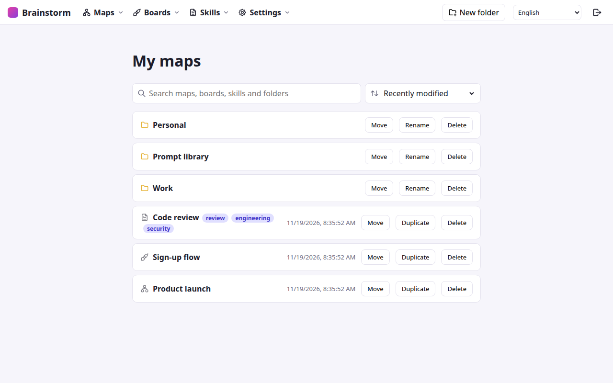
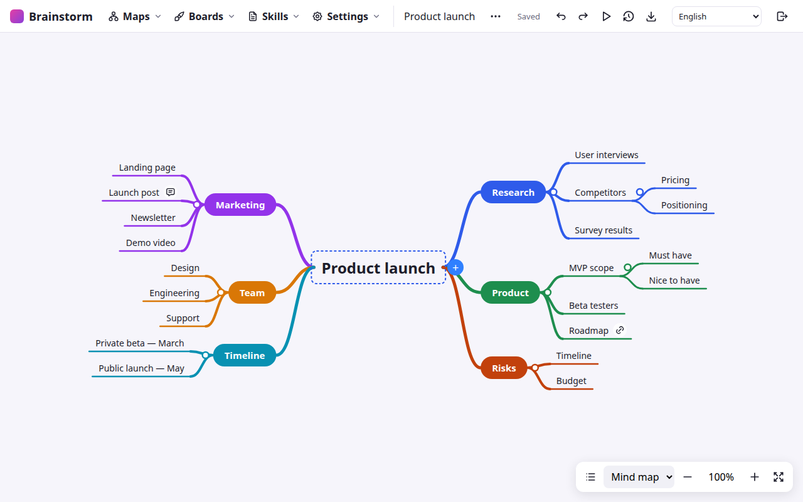
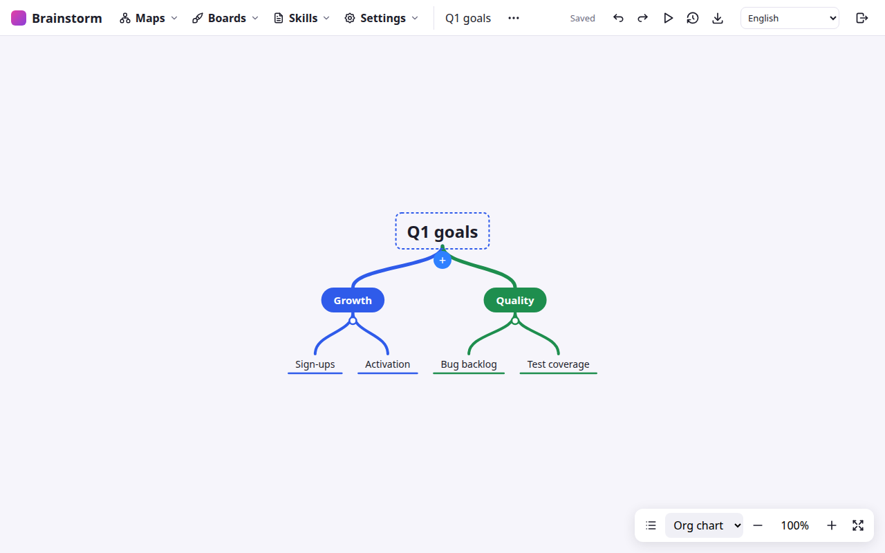
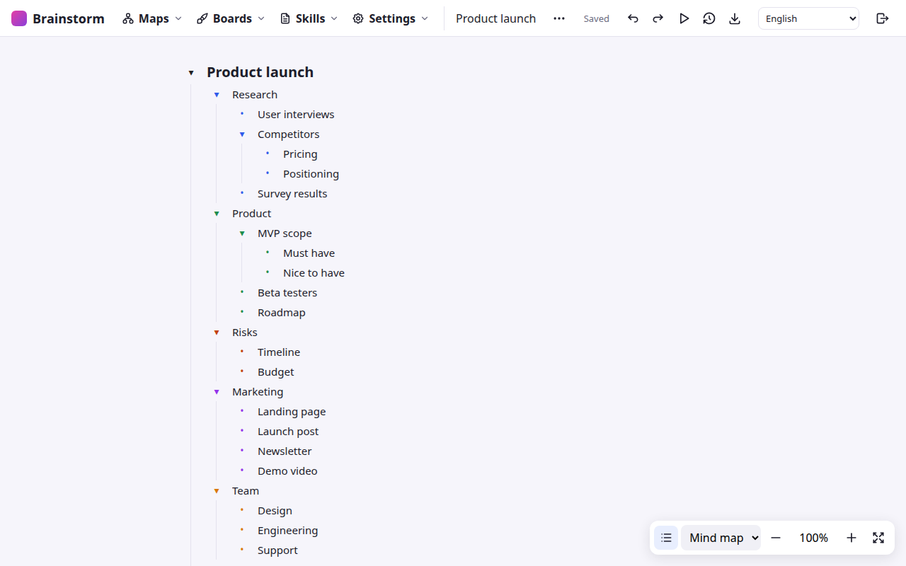
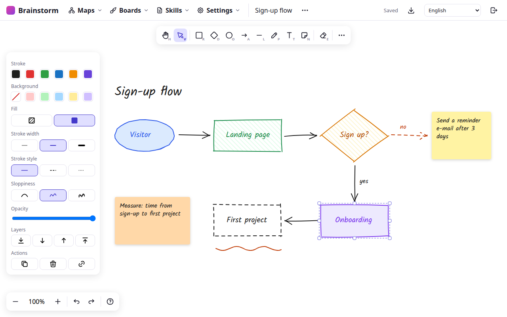
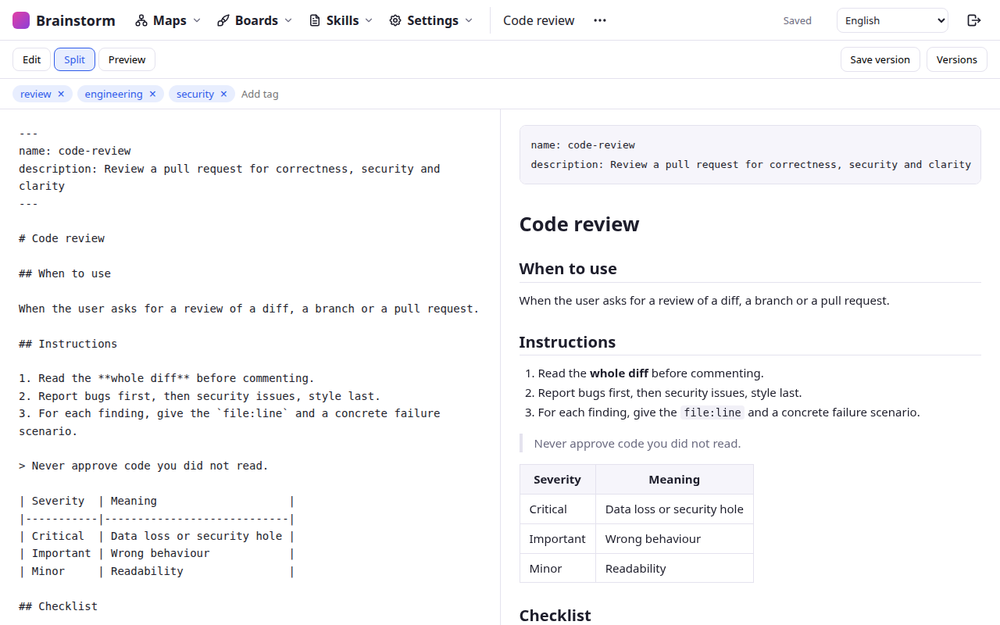
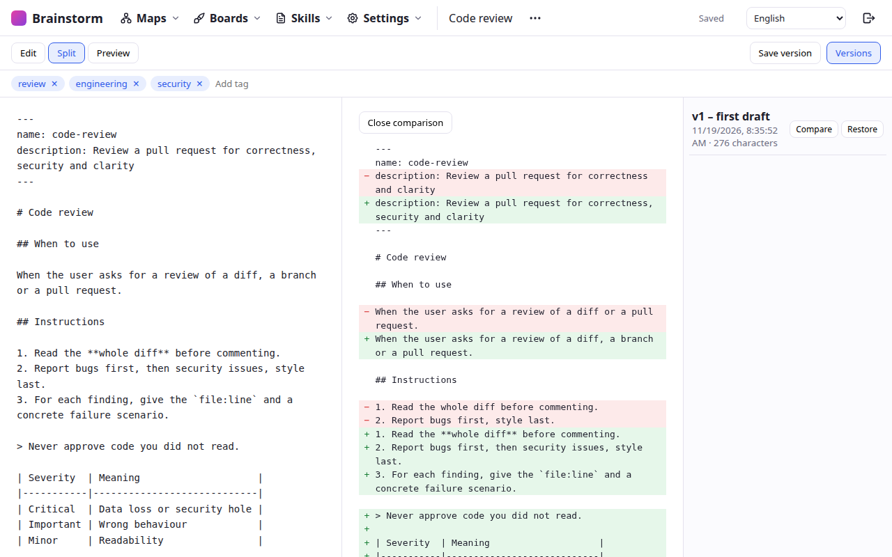
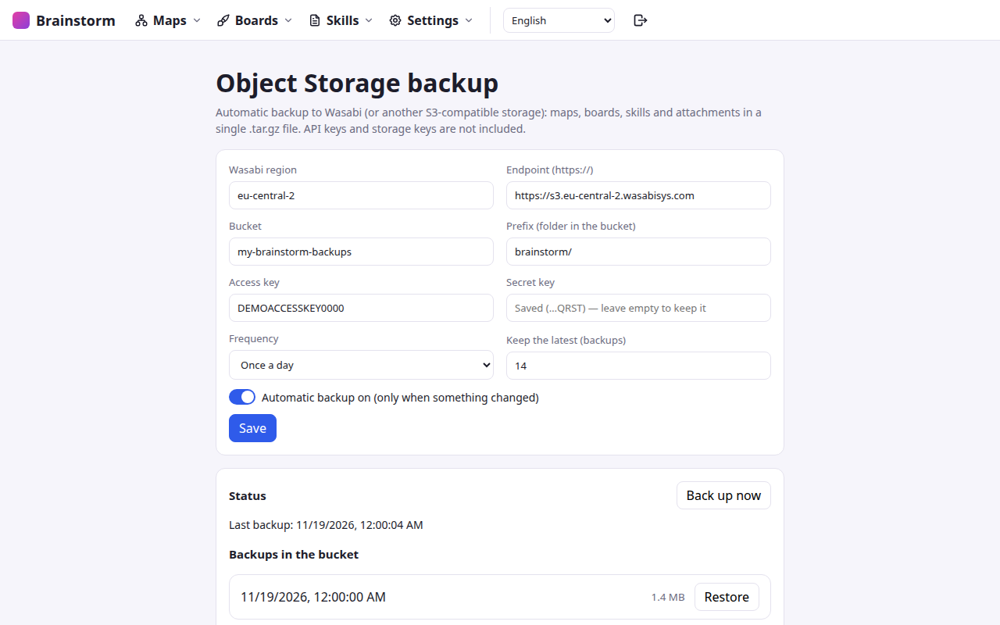
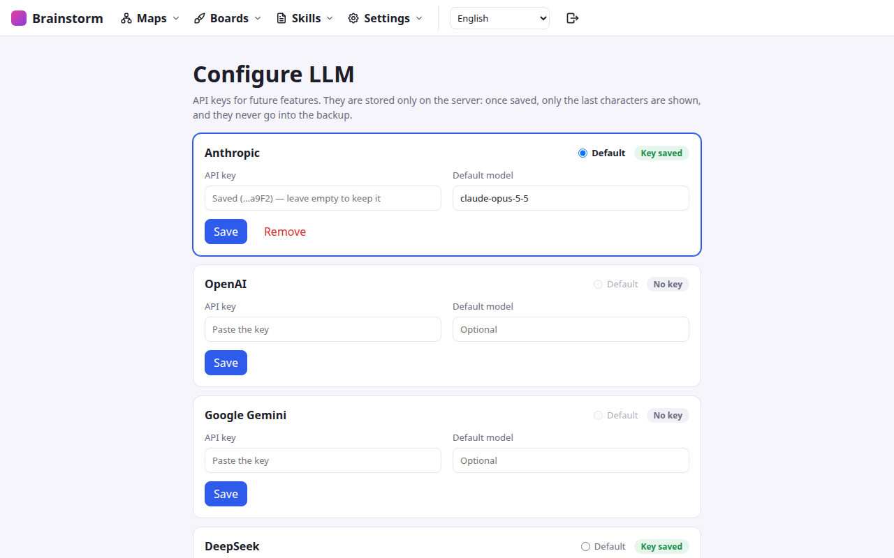
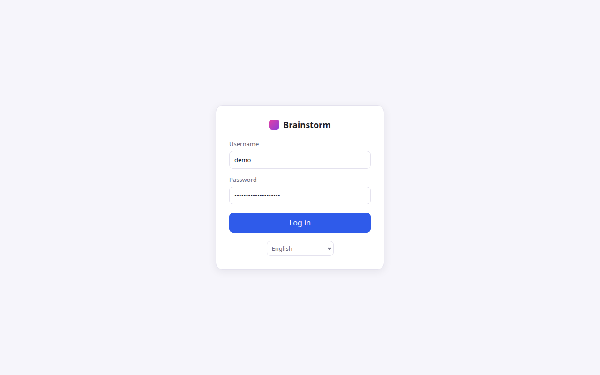

# Brainstorm

Mind maps, drawing boards and skills (Markdown texts for LLMs, with preview, tags and named
versions) for personal use, running on your own machine.

No dependencies: the server is Python's standard library plus SQLite, and the frontend is plain
JavaScript. The interface is available in English, Portuguese (Brazil), Spanish and Japanese.

## Features

### Documents and folders



The home page lists everything you have: mind maps, boards and skills, organised in folders and
subfolders.

- **Folders:** create, rename in place, move (menu or drag and drop) and delete; documents inside a
  deleted folder move up one level.
- **Search and sort:** search by name (and by tag, for skills) across all folders, the trash
  included; sort by last modified or by name.
- **Maps ▾ / Boards ▾ / Skills ▾:** each top menu lists every document of that kind, with the folder
  it lives in, and creates a new one in the folder you have open.
- **Duplicate, trash and restore:** deleting asks first and sends the document to the trash, from
  which it can be restored or removed for good.

### Mind maps



A keyboard-driven mind map editor: `Tab` adds a subtopic, `Enter` a sibling, and the arrow keys
move around.

- **Topics:** text, colour, shape, border and line styles, images, attachments, comments and a web
  link per topic; branches collapse and expand, and drag and drop reorganises them.
- **Links between topics:** connect any two topics with a curved connection that has its own colour
  and end markers.
- **Focus and presentation:** focus on one branch as if it were the whole map, or present the map
  topic by topic.
- **History:** undo and redo, plus a version history that keeps a copy every 2 minutes of editing
  (the last 50) and restores any of them.
- **Copy and paste:** `Ctrl+C` / `Ctrl+X` / `Ctrl+V` work between maps and with other programs
  (a branch becomes an indented list, and an indented list becomes a branch).
- **Export:** PNG, SVG, PDF and Markdown.

Three layouts, switchable at any time — mind map, org chart and list:



The outline mode shows the same map as an editable indented list:



### Boards



A whiteboard with a hand-drawn look, for diagrams and sketches.

- **Tools:** rectangle, diamond, ellipse, arrow, line, pencil, text, sticky note, image, eraser,
  paint bucket, lasso selection and a laser pointer — each with a one-key shortcut.
- **Style panel:** stroke and background colours, fill, stroke width and style, sloppiness, opacity,
  text alignment and font, layer order, and a web link per element.
- **Canvas:** infinite, with pan and zoom; the board reopens exactly where you left it.
- **Copy and paste:** between boards, and images or text from other programs.
- **Export:** PNG and SVG.

### Skills



Skills are Markdown files meant to be used as instructions for LLMs — a personal library of
prompts and procedures.

- **Editor:** Edit, Split and Preview modes; the preview updates as you type and never runs
  scripts or loads remote images.
- **Tags:** add tags as chips; they show in the list and are found by the search.
- **Versions:** on top of the automatic history, "Save version" stores a named version that is
  never pruned.

Any version can be compared with the current text, line by line, and restored (the current text
goes to the history first):



### Automatic backup



Backs up the database and the attachments to Wasabi or any other S3-compatible storage, on a
schedule and only when something changed. Restoring takes two clicks, backs up the current state
first and is all or nothing. Details in [Automatic backup to Wasabi](#automatic-backup-to-wasabi-or-another-s3).

### LLM API keys



Stores API keys for Anthropic, OpenAI, Google Gemini, DeepSeek, OpenRouter or an OpenAI-compatible
server, with a default model per provider and one default provider. The keys stay on the server
— the screen only shows their last characters — and are reserved for future features: nothing in
the app calls an LLM yet.

### Login and languages



An optional login protects the app (see [Login](#login)). The interface is available in English,
Portuguese (Brazil), Spanish and Japanese, switchable from the top bar and from the login page.

## Run with Docker

```bash
mkdir -p data                  # before the first run: otherwise Docker creates the folder as root
docker compose up -d --build
```

Open http://127.0.0.1:8080. Your data lives in `./data` (maps, boards, attachments, history, trash
and folders). To stop: `docker compose down`. After changing the code, run
`docker compose up -d --build` again.

The container uses port 8080 on your machine, so it can run alongside `python3 app.py` (port 8000).
If `docker ps` shows an empty PORTS column, port 8080 was taken when the container started. Free
the port and run `docker compose up -d --force-recreate`.

Another port: change the first number of `127.0.0.1:8080:8000` in `docker-compose.yml` (the second
one, 8000, is the port inside the container and stays as it is).

**Warning:** the app speaks plain HTTP (password and data travel unencrypted) and only answers on
`127.0.0.1` and `localhost`. To reach it from another machine, use an SSH tunnel
(`ssh -L 8080:127.0.0.1:8080 user@server`); never change the port mapping to `0.0.0.0`. It does
not work behind a reverse proxy on another domain: it rejects the address.

## Login

To protect access, create a `.env` (template in `.env.example`):

```bash
cp .env.example .env    # then change the user and the password
```

With `BRAINSTORM_USER` and `BRAINSTORM_PASSWORD` set (in `.env` or as environment variables, which
take precedence), the app asks for a login; without them it opens with no login for any user or
program on this machine. The app does not start with the example password from `.env.example`.
The session lasts 30 days; the "Log out" button is at the top right. After 10 wrong passwords in
10 minutes (in total, wherever they come from), login is locked for a while.

With Docker, `docker-compose.yml` passes both variables to the container. They come from the
environment of whoever runs the command or, if not set there, from `.env`:

```bash
BRAINSTORM_USER=ana BRAINSTORM_PASSWORD='a long password' docker compose up -d
```

After changing the user or the password (either way), run `docker compose up -d` again.

## Where the data lives

```
data/
├── brainstorm.db     ← maps, boards, skills, history, trash and folders (SQLite)
└── attachments/      ← images and attachments, one folder per document
```

To archive to external storage, keeping those two items is enough. With the app running, copy the
database safely like this (the `.db` file alone may be in the middle of a write):

```bash
python3 -c "import sqlite3, os; sqlite3.connect('data/brainstorm.db').backup(sqlite3.connect(os.path.expanduser('~/brainstorm-backup.db')))"
cp -r data/attachments ~/brainstorm-backup-attachments
```

The database copy also carries the login session hashes, a fingerprint (salted scrypt) of the user
and password and, if configured, the API and storage keys (in plain text, `settings` table): keep
it somewhere safe and use a strong password. The automatic backup below leaves all of that out.

Or stop the app (`docker compose down`) and copy the whole `data/` folder.

### Automatic backup to Wasabi (or another S3)

In **Settings ▾ → Configure backup (Object Storage)**: pick the Wasabi region (it fills in the endpoint
`https://s3.<region>.wasabisys.com`), then enter the bucket, prefix (default `brainstorm/`), access
key and secret key, the frequency (6 h, 12 h, daily or weekly) and how many backups to keep
(default 14). When enabled, the app creates a `brainstorm-YYYY-MM-DD-HHMMSS.tar.gz` (UTC) on its
own, only when something changed, and deletes the oldest ones beyond the limit from the prefix;
"Back up now" does it right away. The endpoint must be `https://`.

The archive holds the database and the attachments, but **not** the API keys, the storage
credentials, the login sessions or the user/password fingerprint. To restore, pick a backup from
the list and confirm: the app first backs up the current state (so it can be undone); the swap is
all or nothing, signs nobody out and keeps the settings; while it runs, writes wait (they answer
503), and open tabs reload at the end. A backup from a newer version of the app is refused.

**Configure LLM** holds the API keys (Anthropic, OpenAI, Gemini, DeepSeek, OpenRouter or an
OpenAI-compatible server) for future features: they are stored only on the server, and the screen
shows just the masked ending.

To keep attachments directly on an external disk, use `BRAINSTORM_FILES=/path/to/disk` (with
Docker, see the comment in `docker-compose.yml`).

The first time the database version starts, data in the old format (one `.json` per document) is
imported automatically; the old files are kept in `data/legacy-<date>/`.

## Run without Docker

All you need is Python 3.10 or newer:

```bash
python3 app.py        # http://127.0.0.1:8000  (or: python3 app.py 8080)
```

In this mode the server restarts itself when `app.py` changes, and the page reloads when `static/`
changes.

Optional variables: `BRAINSTORM_HOST` (default `127.0.0.1`), `BRAINSTORM_DATA` (default `./data`),
`BRAINSTORM_FILES` (default `<BRAINSTORM_DATA>/attachments`) and `BRAINSTORM_USER` /
`BRAINSTORM_PASSWORD` (login; see above). Without a login, the app only starts on a local address;
to listen on another address without a login (as inside the container, which only publishes the
port on `127.0.0.1`), set `BRAINSTORM_ALLOW_NO_LOGIN=1`.

## Tests

```bash
python3 -m unittest test_app        # server
python3 -m unittest test_backup     # S3 client (SigV4), backup and restore against a fake S3
node --test tests/*.test.mjs        # logic for maps, boards, skills and folders
node tests/e2e.mjs                  # end to end in headless Chrome (~4 min)
```

The Node tests need Node 22 or newer; the `e2e` also needs `google-chrome` on the PATH.

The screenshots in this README are generated with fictional data by
`node tools/screenshots.mjs` (same requirements as the `e2e`).

## License

[MIT](LICENSE). The icons ([Tabler Icons](static/LICENSE-tabler-icons.txt), MIT) and the
[Kalam](static/fonts/LICENSE-kalam.txt) font (SIL Open Font License) keep their own licenses.
